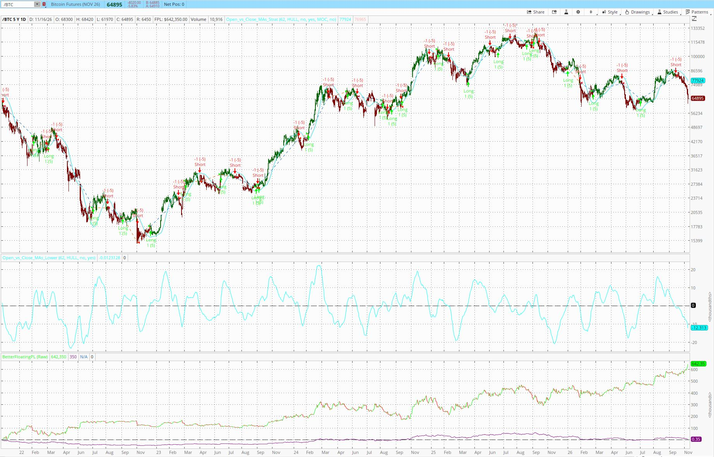

# thinkScript-Scripts-thinkorswim
A Collection of Scripts / Indicators that I have made for thinkScript for the thinkorswim platform.

# Examples ...

## [Open_vs_Close_MAs:](/Custom%20Moving%20Averages/Open_vs_Close/)
#### Studies Used : Parameters  
&emsp;[Open_vs_Close_MAs_Strat](Custom%20Moving%20Averages/Open_vs_Close/Open_vs_Close_MAs_Strat.txt/) : (62, HULL, no, yes, MOC, no)  
&emsp;[Open_vs_Close_MAs_Lower](Custom%20Moving%20Averages/Open_vs_Close/Open_vs_Close_MAs_Lower.txt/) : (62, HULL, no, yes)  
&emsp;[Better_Floating_PL](/.Misc/Better_Floating_PL.txt/) : (Raw)  

 Screenshot taken 11/16/26 at 2:30pm EST. 

#### Explanation:
&emsp;Takes an average of the opening prices, and closing prices. We can assume that if the average closing price is greater than the average opening price, the asset is trending upwards. With that assumption, we can use it to trade. When the average closing price crosses above the average opening price, we can go long. If the inverse happens we can exit the trade, or go short. I find that this strategy is great for catching good swings on trending, yet volatile assets: Assets like Bitcoin and long term bonds (TLT, ZROZ, IEF, etc). Assets that have regular periods of choppiness grind any profits the strategy made away, things like equity, (QQQ, SPY, etc).
